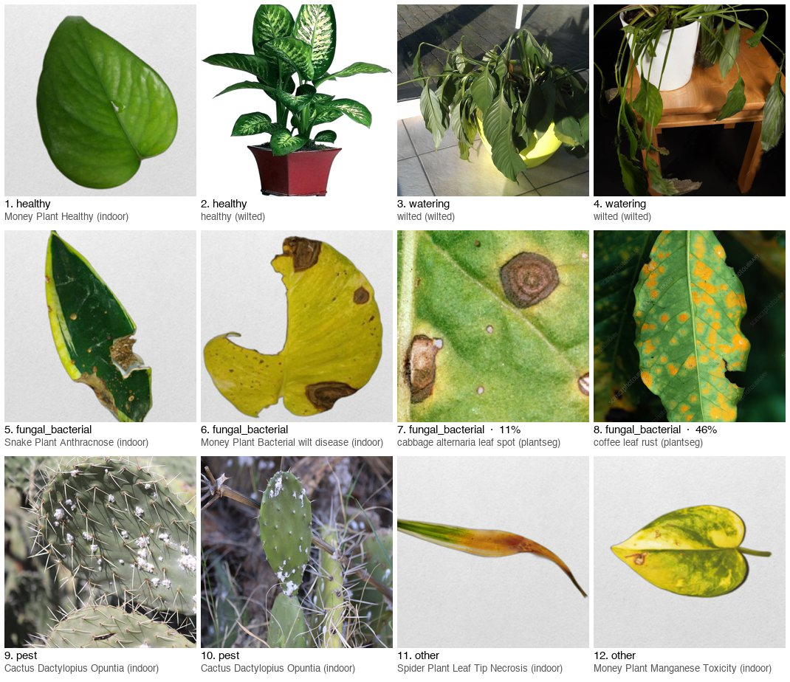

# 10-718: Machine Learning in Practice

## Data

```bash
mkdir -p data/raw && cd data/raw
curl -L -o indoor.zip   https://www.kaggle.com/api/v1/datasets/download/abdulahad0296/indoor-plant-disease-detection-dataset
curl -L -o wilted.zip   https://www.kaggle.com/api/v1/datasets/download/russellchan/healthy-and-wilted-houseplant-images
curl -L -o plantseg.zip https://zenodo.org/api/records/17719108/files/plantseg.zip/content
for z in indoor wilted plantseg; do unzip -q $z.zip -d $z && rm $z.zip; done
```

| Dataset | Images | Train / Valid / Test | Classes | In test set |
|---|---|---|---|---|
| [Indoor Plant Disease Detection](https://www.kaggle.com/datasets/abdulahad0296/indoor-plant-disease-detection-dataset) | 4,865 real (21,097 incl. `Augmented_*` copies) | 4,015 / 455 / 395 real | 16 (5 plants × condition) | 100 |
| [Healthy and Wilted Houseplants](https://www.kaggle.com/datasets/russellchan/healthy-and-wilted-houseplant-images) | 854 unique (904 files) | no splits | 2 (452 healthy / 452 wilted) | 50 |
| [PlantSeg](https://zenodo.org/records/17719108) | 7,774, each with a lesion mask | 5,367 / 846 / 1,561 | 115 diseases, 34 crops | 50 |

## Test set

`python build_testset.py` writes `data/testset.csv` (200 images, labels `healthy / watering / fungal_bacterial / pest / other`).
`data/gold_advice.json` is the advice answer key, from UMD and Clemson extension pages.
`data/curated.csv` is a hand-picked 12-image subset (clear examples of all 5 labels, from all 3 datasets) for manual evaluation, shown one by one in [curated.md](curated.md):



## LLM baseline (Gemini free tier)

Zero-shot classification of the 100 Indoor test images into the dataset's 16 native classes (plant + condition).

```bash
python -m venv .venv && source .venv/bin/activate && pip install -r requirements.txt
cp .env.example .env   # paste a free key from https://aistudio.google.com/apikey
python classify.py     # -> data/preds/<model>.csv (resumable)
python report.py       # -> reports/<model>.md
```

`llm.py` sends each image with a prompt listing the 16 classes and forces the answer to one of them. Set `GEMINI_MODEL` in `.env` to switch model.

Results: [gemini-3.1-flash-lite](reports/gemini-3.1-flash-lite.md): 61% accuracy (random: 6%), plant correct 81%, healthy vs. sick 93%.

## DINOv2 + linear head

A linear classifier on frozen [DINOv2](https://huggingface.co/facebook/dinov2-base) image embeddings, predicting the 5 pooled labels (plant type ignored).
Full explanation (labels, cleaning, results, limits): [reports/dinov2-head.md](reports/dinov2-head.md).
The label of each dataset's classes is in `labels.py`. Images live on `/data/user_data/mdrieux/msml_10718/raw` (`data/raw` links there); jobs run on Babel with `sbatch jobs/run.sbatch <script>`.

```bash
jobs/download.sh                       # the 3 datasets above + PlantDoc (github.com/pratikkayal/PlantDoc-Dataset)
python build_pool.py                   # -> data/pool.csv: every image with its pooled label (no Augmented_* copies)
python embed.py                        # DINOv2 embedding of every image (GPU)
python clean.py                        # -> data/trainval.csv: duplicates merged, copies of test images dropped, 85/15 split
python train_head.py --setting indoor  # -> results/indoor-224px/head.npz, reports/dinov2-head-indoor-224px.md
python train_head.py --setting all     # -> results/all-224px/head.npz,    reports/dinov2-head-all-224px.md
python predict.py results/all-224px/head.npz photo.jpg
```

Results on the 200-image test set (balanced accuracy):

| Trained on | 224 x 224 px | 448 x 448 px (`--image_size 448` in embed.py and train_head.py) |
|---|---|---|
| Indoor dataset only | [71%](reports/dinov2-head-indoor-224px.md) | [70%](reports/dinov2-head-indoor-448px.md) |
| All four datasets | [93%](reports/dinov2-head-all-224px.md) | [94%](reports/dinov2-head-all-448px.md) |

## Asking Claude what is wrong with a plant (`diagnose.py`)

Input: a Reddit-style post, meaning one or more photos plus a title and body text. Two options:

1. **`llm`**: the photos, the post and the question "What is wrong with my plant?" are sent to Claude (`claude-haiku-5-5`).
2. **`llm+classifier`**: the same, plus the DINOv2 classifier's probabilities for each photo. The prompt lists the classifier's 5 classes and says it is often wrong and overconfident on phone photos.

```bash
# once: put your Anthropic API key in .env (git ignores it)
echo 'ANTHROPIC_API_KEY=sk-ant-...' > .env && chmod 600 .env

# runs both options; option 2 needs DINOv2, so run it on a compute node
sbatch -J diagnose jobs/run.sbatch '$PY diagnose.py --image photo.jpg --title "SOS" --body "Leaves went black overnight" --out results/llm/sos.json'
python diagnose.py --image photo.jpg --title "..." --body "..." --dry_run   # show the prompts without calling the API
```

`--mode llm` or `--mode llm+classifier` runs a single option. `--head` picks the classifier (default `results/all-224px/head.npz`). The prompt text is at the top of `diagnose.py`. `--model claude-opus-5-5` uses Opus instead of the default Haiku. First results on 3 Reddit photos: [reports/llm-reddit.md](reports/llm-reddit.md).

## Reddit "advice that worked" dataset (`reddit/`)

96 Reddit threads where OP came back to confirm a commenter's advice worked, each cut to a verbatim question → answer → outcome with its photos: `data/reddit/resolved/threads.csv` and `data/reddit/resolved/images/`. Images are `{Image_01}`, `{Image_02}`, ... placeholders in the text, filled with `str.format` from the `Image_NN` path columns. Columns, guarantees, caveats and loaders for Claude, Gemini and `diagnose.py`: [data/reddit/resolved/README.md](data/reddit/resolved/README.md). The scrape → label → one-turn pipeline: [reddit/README.md](reddit/README.md).

## Claude on the 96 resolved Reddit threads (`eval_resolved.py`)

Runs `diagnose.py` (Haiku) on every thread of `data/reddit/resolved/threads.csv`, with and without the classifier's output, and has a second Haiku call grade each answer blind against the thread's confirmed problem, the advice that worked and the poster's outcome. Result: adding the classifier makes no clear difference (diagnosis score 0.59 vs 0.59, advice score 0.55 vs 0.58). Report: [reports/llm-resolved-haiku-5-5.md](reports/llm-resolved-haiku-5-5.md); per-thread answers, grades and the grader's reasons: `results/llm/resolved-haiku-5-5/`.

```bash
sbatch -J resolved -c 2 --mem=16G --time=00:30:00 jobs/run.sbatch 'jobs/eval_resolved.sh'   # resumes; --model claude-opus-5-5 for Opus
```

## Prompt design, web search and model choice (`reports/prompt-design.md`)

**Question.** Do system-prompt additions or web search make Claude's answers match the fix that worked more often?

**Setup.**
- Prompt work used the 32 development threads only; the 64 test threads were held out for the final checks.
- Every addition was ablated one element at a time, with and without web search.
- Reddit and its mirrors are blocked in search, and every query and result URL is saved with the answer.
- Each answer is graded by Sonnet 5.5.

**Results.**
- **No prompt element and no web search beats `guided-v2`**, for Haiku or for Opus. The elements were plant-care notes,
  common causes ranked, answer format rules, reasoning instructions and removing checklist items.
- **Changing the model does help.** Opus 5.5 at max effort, with `guided-v2` and no search, on all 96 threads, scores
  0.755 on advice, against 0.653 for Haiku: +0.10 [+0.05, +0.16]. Its harmful answers drop from 10% to 2%.
- **High effort does as well as max** on the 32 threads where both were run, at about a tenth of the cost.

**Where the outputs are.**
- Tables, ablations and costs: [reports/prompt-design.md](reports/prompt-design.md).
- Per-run reports: `reports/llm-resolved-*-graded-sonnet-5-5.md`.
- Answers, search logs and grades, by model, prompt and setting:
  `results/llm/resolved-<model>-<prompt>[-search][-<effort>]/{answers,grades-sonnet-5-5}/`.

```bash
python eval_resolved.py --prompt guided-v2+kb --threads dev --options llm --samples 6 --grader claude-sonnet-5-5   # one variant
python eval_resolved.py --model claude-opus-5-5 --effort high --prompt guided-v2 --search research --threads test --grader claude-sonnet-5-5
python jobs/run_many.py "<args of run 1>" "<args of run 2>" ...   # several runs in one process (login-node thread limit)
python jobs/compare_prompts.py dev   # paired comparison with guided-v2, and the API spend so far
```

Prompt elements: `diagnose.py` `ELEMENTS`. A prompt name `guided-v2+<element>+...` adds them in that order;
`drop<k>` removes item k of the checklist.
